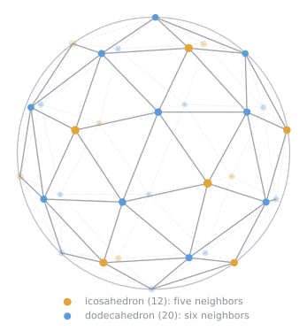
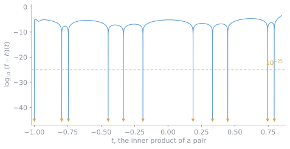

*This post, including its interactive figures, was drafted by Claude Opus 5.5 and reviewed by me.*

How should 32 electrons arrange themselves on a sphere so that their total repulsion is as small as possible? Numerical searches have long pointed to one answer: the twelve vertices of a regular icosahedron together with the twenty vertices of its dual dodecahedron. Claude Fable 5.1, an AI model by Anthropic, found a proof under my direction: this arrangement is the minimum, and the only one up to rotation, reflection, and relabeling. As far as I know, this case had not been settled before. The proof is written in Lean 4 and is accepted by Lean's kernel. It has not yet been reviewed by experts.

<figure class="wide t32" id="t32-config">
<div class="t32-stage"><noscript></noscript></div>
<figcaption>The 32 points. Each icosahedron point has five nearest neighbors and each dodecahedron point six. Joining neighbors cuts the sphere into 60 near-equal triangles, and the cells around the points are the 12 pentagons and 20 hexagons of a soccer ball. Tap a point to see how few different angles it makes with the other 31.</figcaption>
</figure>

## The problem

Put $N$ points $x_1, \dots, x_N$ on the unit sphere in $\mathbb{R}^3$ and give each pair the Coulomb energy $1/\|x_i - x_j\|$. The Thomson problem, posed by J. J. Thomson in 1904, asks for the arrangement with the smallest total energy

$$
E(x) = \sum_{i<j} \frac{1}{\|x_i - x_j\|}.
$$

Computers have found good candidates for every $N$ up to several hundred, but proofs are rare. The cases $N = 2, 3, 4, 6, 12$ are classical. $N = 5$ was settled by Richard Schwartz with a computer-assisted proof. In 2026, Lean-verified proofs appeared for $N = 7$ ([thomson-n7-lean](https://github.com/huwngtran/thomson-n7-lean)), $N = 8$ ([Kryvonos, Liehr, and Taylor](https://arxiv.org/abs/2609.22077)), and $N = 9$ and $10$ ([thomson-n9-lean](https://github.com/aravindkarthigeyan/thomson-n9-lean), [clank-lab](https://github.com/6/clank-lab/tree/thomson-10-v3/results/thomson-10)).

For $N = 32$ the candidate has full icosahedral symmetry. The dodecahedron's vertices sit over the centers of the icosahedron's faces, so on the sphere the 32 points are the centers of the 12 pentagons and 20 hexagons of a soccer ball. Its energy is

$$
E = 412.2612746505293\ldots
$$

## Everything is a function of the angles

For unit vectors, write $t_{ij} = x_i \cdot x_j$, the cosine of the angle between two points. Expanding the squared distance gives

$$
\|x_i - x_j\|^2 = 2 - 2t_{ij},
$$

so each pair contributes $f(t_{ij})$ with

$$
f(t) = \frac{1}{\sqrt{2 - 2t}}.
$$

The energy depends only on the $496$ numbers $t_{ij}$. They are not free, though: they have to come from real points in three dimensions. For example, the three inner products $u, v, s$ of any three points satisfy

$$
1 + 2uvs - u^2 - v^2 - s^2 \ge 0.
$$

All of the difficulty lives in these constraints. Thanks to its symmetry, the candidate uses only 11 distinct values of $t$: $-1$, $\pm 0.1876$, $\pm 1/3$, $\pm 0.4472$, $\pm 0.7454$, and $\pm 0.7947$.

<figure class="wide t32" id="t32-triples">
<div class="t32-stage"></div>
<figcaption>Every three points on a sphere give three inner products $(u, v, s)$, and these always land in this solid, where $1 + 2uvs - u^2 - v^2 - s^2 \ge 0$. The candidate’s 4,960 triples of points come in only 60 different shapes, the dots, each shown in every order of $u, v, s$. The certificate of step 1 below is written in exactly these three variables.</figcaption>
</figure>

## The proof in three steps

**1. A lower bound for every configuration.** The proof uses a polynomial $h$ of degree 32 that lies below $f$ on $[-1, 1)$. Then for every configuration

$$
E(x) = \sum_{i<j} f(t_{ij}) \ \ge\ \sum_{i<j} h(t_{ij}).
$$

The right side is bounded below by an explicit number $B$ using a *three-point certificate* in the sense of Cohn and Woo. This is one polynomial identity in the three inner products $u, v, s$ of a triple of points, written as a sum of terms that can never be negative for points on a sphere. Some of them are squares, others are kernels that are positive semidefinite on the sphere. Summing the identity over all triples gives $\sum h(t_{ij}) \ge B$ for every configuration at once.

The certificate has degree 16 and 29 blocks, with every coefficient an exact fraction on a $10^{-60}$ grid. It is *sharp*: $B$ falls short of the candidate's energy by less than $4 \times 10^{-42}$. For that to happen, $h$ has to touch $f$ at each of the 11 values the candidate uses, since every pair of the candidate contributes $f(t_{ij})$ on one side and $h(t_{ij})$ on the other.

Drawn on the same axes, $f$ and $h$ would look like one curve. What matters is the gap $f - h$, which is never negative. In the figure below it is drawn on a log scale, where each grid line down is another factor of $10^{10}$. At the 11 values the gap is about $10^{-45}$, and it climbs steeply away from them.

**2. Every pair is trapped in a window.** Take any configuration whose energy is at most the candidate's. Then

$$
\sum_{i<j} (f - h)(t_{ij}) = E(x) - \sum_{i<j} h(t_{ij}) \ \le\ E(\text{candidate}) - B,
$$

since $E(x)$ is at most the candidate's energy and $\sum h(t_{ij})$ is at least $B$. So the 496 gaps share a budget of less than $4 \times 10^{-42}$. None of them is negative, so each one is below that budget too. But outside windows of half-width $10^{-10}$ around the 11 values, $f - h$ is at least $10^{-25}$. So every $t_{ij}$ lies within $10^{-10}$ of one of the 11 values.

The figure lets you try this. It moves each point of the candidate in a random direction by an angle you choose, and plots the 496 pairs of the result on the gap. For large moves, some pair leaves its window and its gap alone exceeds the budget. For smaller moves, every pair stays inside, but the gaps still add up to more than the budget. Below about $10^{-21}$, the bound alone can no longer tell the moved configuration from the candidate. That is where step 3 takes over.

<figure class="wide t32" id="t32-gap">
<div class="t32-stage"><noscript></noscript></div>
<figcaption>Left: the gap $f - h$ over all $t$. Right: the same gap near each of the 11 values $c$, plotted against the distance $|t - c|$. Inside the window, the gap grows like the square of the distance. The one curve that rises much sooner belongs to $t = -1$: there $h$ only has to stay below $f$ at the end of the interval, so the gap grows linearly. The dots are the 496 pairs of the moved configuration. The gap comes from the certificate's own coefficients evaluated to 130 digits. The energy difference is computed without the loss of digits that a direct subtraction would cause.</figcaption>
</figure>

**3. From windows to the candidate.** A finite classification, checked by computer, shows that the only way to assign the 496 pairs to windows consistently with three-dimensional geometry is the candidate's own pattern, up to relabeling. It uses the fact that the Gram determinants of any four points in $\mathbb{R}^3$ vanish, and runs over all 286 ways to color a triangle with the 11 values, 152 of which can anchor the search. A configuration with that pattern can be rotated to within $10^{-6}$ of the candidate. There, a local argument finishes. The candidate is a critical point, and its $96 \times 96$ Hessian, made definite by penalizing rotations and radial motion, is certified exactly. So any nearby configuration has energy strictly above the candidate's unless it *is* the candidate.

Together the three steps give both claims. Nothing has lower energy, and anything with equal energy is a rotated, reflected, or relabeled copy.

## The formal statement

The whole claim is one Lean proposition. Its file imports only Mathlib, so nothing else in the project can change its meaning.

```lean
def ThomsonThirtyTwo : Prop :=
  ∀ x : Fin 32 → R3, (∀ i, ‖x i‖ = 1) → Function.Injective x →
    energy candidate ≤ energy x ∧
    (energy x = energy candidate ↔
      ∃ (g : R3 ≃ₗᵢ[ℝ] R3) (σ : Equiv.Perm (Fin 32)), ∀ i, x i = g (candidate (σ i)))
```

In words: for any 32 distinct unit vectors $x$, the candidate's energy is at most that of $x$. And the two are equal exactly when $x$ is the candidate moved by an orthogonal map $g$ (a rotation or reflection) and relabeled by a permutation $\sigma$. Here `energy` is the sum over pairs above, and `candidate` lists the 32 points in closed form using the golden ratio. The distinctness hypothesis is needed because Lean defines $1/0 = 0$. Without it, stacked points would count as free.

This statement is the one part of the work that Lean cannot check for us. Lean checks that the proof proves *this* proposition, but whether the proposition says what we mean is for people to judge.

## Verification

The proof is the theorem `thomson_thirty_two : ThomsonThirtyTwo`.

| Check | Result |
| --- | --- |
| Build from source (Lean 4.34.1, pinned Mathlib) | 9,697 jobs, no errors |
| Axioms of the final theorem | `propext`, `Classical.choice`, `Quot.sound` only |
| `sorry`, `native_decide`, added axioms | none |
| Kernel replay with `leanchecker --fresh` | accepted |

The kernel replay re-checks the whole proof, Mathlib included, from an empty environment. It uses Lean's own kernel, so it is a second pass rather than an independent checker. Every computation in the proof, including the certificate identity, the positivity checks, and the classification, runs inside the kernel via `decide +kernel`.

The project has 772 modules and about 3.5 million lines. 72 modules are hand-written; the other 700 hold the certificate data and the generated checks. Building it needs a large machine: about 100 GB of memory and one to three hours, plus about six hours for the replay.

I also had two fresh AI sessions review the project with no context beyond the Lean files. Each worked out on its own what the statement asserts and looked for gaps. One rebuilt and re-checked everything. Neither found an error in the statement or the proof. That is not expert review, and I would welcome it.

## How this was produced

All of the mathematics, the search for the certificate, every Lean module, the verification scripts, and the paper describing the proof were produced by Claude Fable 5.1, running at high effort in Claude Code. The work ran in sessions between late October and early November 2026, and the proof was completed on November 3.

My part was to direct the sessions, to audit the formal statement, and to publish the work. Fable surveyed the cases up to $N = 100$, and we narrowed its list of candidates down to $N = 32$ together. The rules were that the formal statement had to be written first and audited by me before any proof was attempted, and that every claim had to be labeled by its evidence. Apart from the formal statement, the correctness of the proof rests on the Lean kernel.

The architecture of the proof, including the certificate checker, the three-point framework, the window classification, and the local rigidity argument, is adapted from two earlier open developments: the $N = 9$ proof in [thomson-n9-lean](https://github.com/aravindkarthigeyan/thomson-n9-lean) (MIT License) and the $N = 10$ proof in [clank-lab](https://github.com/6/clank-lab/tree/thomson-10-v3/results/thomson-10) (Apache License 2.0). The three-point bound is due to Henry Cohn and Jeechul Woo.

---

The Lean project, the paper, the documents describing the claim and the proof, and the scripts that repeat every check: [github.com/8dgkim/thomson-n32-lean](https://github.com/8dgkim/thomson-n32-lean)

<script defer src="figures/data.js"></script>
<script defer src="figures/figures.js"></script>
